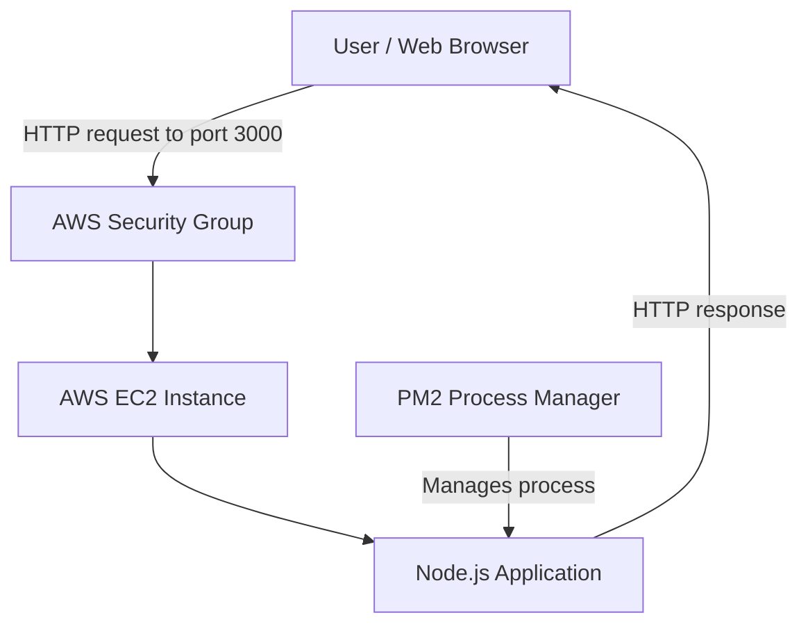

# Node.js Application Deployment on AWS EC2

## 1. Introduction

This project demonstrates how to deploy a Node.js application on an Amazon Web Services (AWS) EC2 instance. PM2 is used to start and manage the application process.

The deployed application displays the message:

> Hiii from jenkins, added webhook, we are from 18 May Devops batch

## 2. Technologies Used

- AWS EC2
- Node.js
- PM2
- Linux
- Web browser

## 3. Architecture Diagram



## 4. Input / Execution Screenshot

The screenshot below shows the terminal command used to start the Node.js application with PM2 and the process status shown as online.


Command used:

```bash
sudo pm2 start app.js
```

## 5. Output Screenshot

The screenshot below shows the application running in a browser on the EC2 public IP address using port 3000.


## 6. Deployment Steps

1. Launch an EC2 instance and connect to it.
2. Install Node.js and npm.
3. Copy the Node.js application files to the EC2 instance.
4. Install PM2 if it is not installed:

   ```bash
   sudo npm install -g pm2
   ```

5. Start the application:

   ```bash
   sudo pm2 start app.js
   ```

6. Check the process status:

   ```bash
   sudo pm2 status
   ```

7. Allow the required inbound TCP port in the EC2 security group.
8. Open the application in a browser using `http://<EC2-PUBLIC-IP>:3000`, replacing the placeholder with your instance's public IP address.

## 7. Conclusion

This project provided practical experience in deploying a Node.js application on AWS EC2. It demonstrated how to use PM2 to manage the application process and verify the result through a web browser.

## Security Note

The example uses HTTP on port 3000. For production use, configure HTTPS and restrict network access to only the sources that need it. Avoid sharing credentials, private keys, or other sensitive information.
